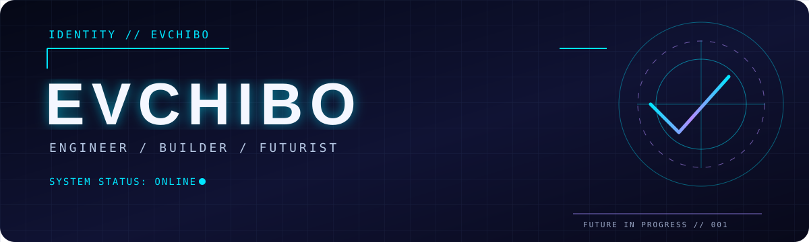

<div align="center">



### `> THE FUTURE IS A WORK IN PROGRESS_`

**Designing thoughtful experiences. Engineering resilient systems. Exploring what comes next.**

[](https://github.com/evchibo?tab=repositories)
[](https://github.com/evchibo?tab=followers)

</div>

---

## `01 / IDENTITY SIGNAL`

```text
> boot sequence initialized
> handle: evchibo
> mode: BUILD · EXPERIMENT · EVOLVE
> mission: Make complex technology feel effortless.
> status: ONLINE █
```

I'm a software developer interested in the space where **software engineering, developer experience, digital infrastructure, and interface design** meet. I build, explore, refactor, and iterate — with curiosity as the constant.

## `02 / TECHNOLOGY MATRIX`

<div align="center">


</div>

## `03 / PROJECT TRANSMISSIONS`

| Project | Focus |
| :--- | :--- |
| [**Frica ID SDK**](https://github.com/evchibo/frica-id-sdk) | Identity integration for JavaScript and TypeScript |
| [**Frica ID Flutter**](https://github.com/evchibo/frica-id-flutter) | Identity integration for Flutter |
| [**Developer Tools**](https://github.com/evchibo/dev-tools) | Tools and engineering utilities |
| [**Flutter Share**](https://github.com/evchibo/flutter_share) | Flutter ecosystem development |
| [**WebViewX Plus**](https://github.com/evchibo/webviewx_plus) | Cross-platform WebView tooling |
| [**Cached Video Player**](https://github.com/evchibo/cached_video_player) | Video playback tooling |

*More experiments, projects, and contributions are available in the [repository archive](https://github.com/evchibo?tab=repositories).*

## `04 / GITHUB ACTIVITY`

<div align="center">

[](https://github.com/evchibo?tab=repositories)
[](https://github.com/evchibo)

</div>

GitHub's native contribution calendar appears on [my profile](https://github.com/evchibo) and is the most reliable source of activity data. Dynamic third-party charts are intentionally omitted to avoid broken images.

## `05 / DESIGN PRINCIPLES`

```yaml
mindset:
  - Think in systems
  - Design for humans
  - Build for resilience
  - Keep learning
  - Ship, observe, improve
frontiers:
  - Developer platforms
  - Secure infrastructure
  - Cross-platform experiences
  - Intelligent interfaces
```

<div align="center">

### `STAY CURIOUS. KEEP BUILDING.`

[Contribution animation workflow](https://github.com/evchibo/evchibo/actions/workflows/snake.yml) · The animation will be embedded once its generated output is confirmed available.


</div>
